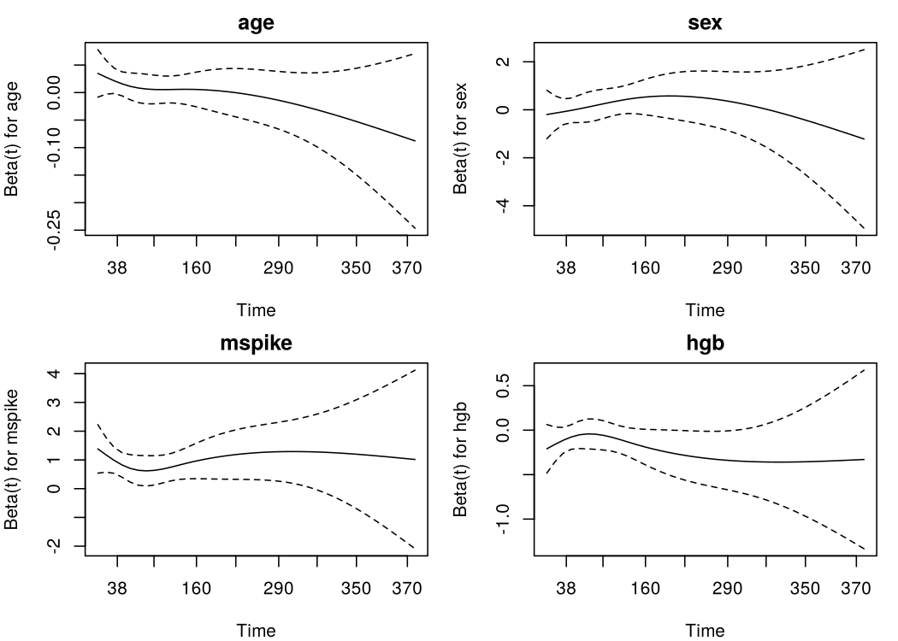

Case 1: Competing risks in MGUS progression
================

- [Question](#question)
- [Data](#data)
- [Analysis plan](#analysis-plan)
- [1. Cumulative incidence: why 1 − KM is wrong
  here](#1-cumulative-incidence-why-1--km-is-wrong-here)
- [2. Cause-specific Cox models](#2-cause-specific-cox-models)
- [3. Fine–Gray subdistribution hazard
  model](#3-finegray-subdistribution-hazard-model)
- [4. Comparing the models](#4-comparing-the-models)
- [5. Proportional hazards check](#5-proportional-hazards-check)
- [Limitations](#limitations)
- [References](#references)

## Question

Monoclonal gammopathy of undetermined significance (MGUS) is a
pre-malignant plasma-cell disorder. Some patients progress to a
plasma-cell malignancy (PCM, mostly multiple myeloma), but most MGUS
patients are elderly and many die of other causes first. Two questions
follow:

1.  **What is the long-term risk of progressing to PCM?**
2.  **Which baseline factors are associated with progression?**

Death before progression is a *competing risk*: it does not just hide
the outcome (as censoring does), it makes the outcome impossible. This
case shows how ignoring that changes the answers to both questions.

## Data

`survival::mgus2`: 1384 patients diagnosed with MGUS at the Mayo Clinic
(Kyle et al., *NEJM* 2002). Time is in months from diagnosis.

``` r
d <- mgus2 |>
  mutate(
    etime = ifelse(pstat == 0, futime, ptime),          # time to first event
    event = factor(ifelse(pstat == 0, 2 * death, 1), 0:2,
                   c("censored", "PCM", "death")),     # first event type
    sex   = factor(sex, c("F", "M"), c("Female", "Male"))
  )

count(d, event)
```

    ##      event   n
    ## 1 censored 409
    ## 2      PCM 115
    ## 3    death 860

Each patient contributes one first event: progression to PCM, death
without progression, or censoring. Deaths outnumber progressions by more
than 7 to 1.

## Analysis plan

| Step          | Method                                                   | Purpose                                                                    |
|---------------|----------------------------------------------------------|----------------------------------------------------------------------------|
| Absolute risk | Aalen–Johansen cumulative incidence vs. 1 − Kaplan–Meier | Show the bias from treating death as censoring                             |
| Etiology      | Cause-specific Cox model for each event                  | Effect of covariates on the *rate* of each event among those still at risk |
| Prediction    | Fine–Gray subdistribution hazard model                   | Effect of covariates on the *cumulative incidence* of PCM                  |
| Diagnostics   | Schoenfeld residual tests                                | Check proportional hazards in the cause-specific models                    |

Covariates: age, sex, M-spike size (g/dL) and hemoglobin (g/dL). Models
use complete cases.

## 1. Cumulative incidence: why 1 − KM is wrong here

``` r
aj  <- survfit(Surv(etime, event) ~ 1, data = d)               # Aalen–Johansen
km  <- survfit(Surv(etime, event == "PCM") ~ 1, data = d)      # deaths censored

times <- seq(0, 420, by = 6)
aj_s  <- summary(aj, times = times, extend = TRUE)
km_s  <- summary(km, times = times, extend = TRUE)

cif <- bind_rows(
  tibble(time = times, risk = aj_s$pstate[, which(aj$states == "PCM")],
         method = "Aalen–Johansen (death as competing risk)"),
  tibble(time = times, risk = 1 - km_s$surv,
         method = "1 − Kaplan–Meier (death treated as censoring)")
)

ggplot(cif, aes(time / 12, risk, colour = method, linetype = method)) +
  geom_step(linewidth = 0.8) +
  scale_y_continuous(labels = scales::percent, limits = c(0, 0.5)) +
  labs(x = "Years since MGUS diagnosis", y = "Cumulative incidence of PCM",
       colour = NULL, linetype = NULL) +
  scale_colour_manual(values = c("#1b6ca8", "#c0392b")) +
  theme(legend.position = "bottom", legend.direction = "vertical")
```

<!-- -->

``` r
yrs <- c(10, 20, 30)
tibble(
  `Years` = yrs,
  `Aalen-Johansen` = summary(aj, times = yrs * 12)$pstate[, which(aj$states == "PCM")],
  `1 - KM` = 1 - summary(km, times = yrs * 12)$surv
) |>
  mutate(across(-Years, scales::percent, accuracy = 0.1)) |>
  knitr::kable()
```

| Years | Aalen-Johansen | 1 - KM |
|------:|:---------------|:-------|
|    10 | 6.4%           | 9.5%   |
|    20 | 10.0%          | 21.0%  |
|    30 | 13.4%          | 42.5%  |

At 30 years, 1 − KM puts the risk of progression at 42.5%, roughly three
times the Aalen–Johansen estimate of 13.4%. Few patients remain at risk
that late, so the tail is imprecise, but the gap is already twofold at
20 years. The KM approach estimates risk in a hypothetical world where
nobody dies of other causes. For counselling a real patient, the
Aalen–Johansen estimate is the relevant one.

## 2. Cause-specific Cox models

``` r
cc <- d |> filter(!is.na(hgb), !is.na(mspike))

cs_pcm   <- coxph(Surv(etime, event == "PCM")   ~ age + sex + mspike + hgb, data = cc)
cs_death <- coxph(Surv(etime, event == "death") ~ age + sex + mspike + hgb, data = cc)
```

Complete cases: 1360 of 1384 patients.

## 3. Fine–Gray subdistribution hazard model

``` r
fg_data <- finegray(Surv(etime, event) ~ ., etype = "PCM",
                    data = select(cc, etime, event, age, sex, mspike, hgb))
fg_pcm  <- coxph(Surv(fgstart, fgstop, fgstatus) ~ age + sex + mspike + hgb,
                 weights = fgwt, data = fg_data)
```

## 4. Comparing the models

``` r
tidy_hr <- function(fit, model) {
  tidy(fit, exponentiate = TRUE, conf.int = TRUE) |>
    transmute(term, model,
              HR = sprintf("%.2f (%.2f, %.2f)", estimate, conf.low, conf.high))
}

bind_rows(
  tidy_hr(cs_pcm,   "Cause-specific: PCM"),
  tidy_hr(cs_death, "Cause-specific: death"),
  tidy_hr(fg_pcm,   "Fine-Gray: PCM")
) |>
  mutate(term = recode(term, age = "Age (per year)", sexMale = "Male",
                       mspike = "M-spike (per g/dL)", hgb = "Hemoglobin (per g/dL)")) |>
  pivot_wider(names_from = model, values_from = HR) |>
  rename(Covariate = term) |>
  knitr::kable(caption = "Hazard ratios (95% CI)")
```

| Covariate             | Cause-specific: PCM | Cause-specific: death | Fine-Gray: PCM    |
|:----------------------|:--------------------|:----------------------|:------------------|
| Age (per year)        | 1.01 (1.00, 1.03)   | 1.06 (1.05, 1.07)     | 0.98 (0.97, 0.99) |
| Male                  | 1.14 (0.77, 1.68)   | 1.67 (1.45, 1.92)     | 0.82 (0.57, 1.18) |
| M-spike (per g/dL)    | 2.48 (1.79, 3.43)   | 0.92 (0.81, 1.04)     | 2.51 (1.88, 3.36) |
| Hemoglobin (per g/dL) | 0.88 (0.79, 0.98)   | 0.86 (0.83, 0.90)     | 0.99 (0.90, 1.08) |

Hazard ratios (95% CI)

**Reading the table.**

- **M-spike** raises the rate of progression (cause-specific HR 2.48)
  and has no clear effect on death, so its subdistribution HR is almost
  identical (2.51). When a covariate only affects the event of interest,
  the two models agree.
- **Age** barely changes the rate of progression (cause-specific HR
  1.012 per year, CI includes 1) but strongly raises the rate of death
  (1.060). Older patients are therefore more likely to die before they
  can progress, which is why the Fine–Gray HR for age is *below* 1
  (0.982). Age does not protect against myeloma; it lowers the
  probability of ever being diagnosed with it.
- **Hemoglobin**: lower hemoglobin is associated with higher rates of
  both progression and death. The two effects partly cancel in the
  cumulative incidence, so the Fine–Gray HR is close to 1.

The two models answer different questions. Cause-specific HRs describe
etiology (does this factor speed up progression among people still alive
and at risk?). Subdistribution HRs describe prediction (does this factor
change the chance a patient is ever diagnosed?). Reporting only one of
them can mislead, especially for covariates such as age that also drive
the competing event.

## 5. Proportional hazards check

``` r
zph <- cox.zph(cs_pcm)
zph
```

    ##         chisq df    p
    ## age    2.6222  1 0.11
    ## sex    0.2321  1 0.63
    ## mspike 0.0211  1 0.88
    ## hgb    0.2625  1 0.61
    ## GLOBAL 3.5611  4 0.47

No covariate shows evidence against proportional hazards in the
progression model (global p = 0.47).

``` r
par(mfrow = c(2, 2), mar = c(4, 4, 2, 1))
for (i in 1:4) plot(zph[i], resid = FALSE, main = rownames(zph$table)[i])
```

<!-- -->

## Limitations

- Complete-case analysis drops 24 patients with missing hemoglobin or
  M-spike; multiple imputation would be a natural extension.
- Data come from a single referral center (southeastern Minnesota), with
  diagnoses from 1956 onward; absolute risks may not transfer to current
  populations.
- Creatinine was not included because of additional missingness.

## References

- Kyle RA, et al. A long-term study of prognosis in monoclonal
  gammopathy of undetermined significance. *NEJM* 2002;346:564–9.
- Fine JP, Gray RJ. A proportional hazards model for the subdistribution
  of a competing risk. *JASA* 1999;94:496–509.
- Therneau T, Crowson C, Atkinson E. *Multi-state models and competing
  risks*. Vignette for the `survival` package.

<!-- -->

    ## [1] "R version 4.3.3 (2024-02-29)"
