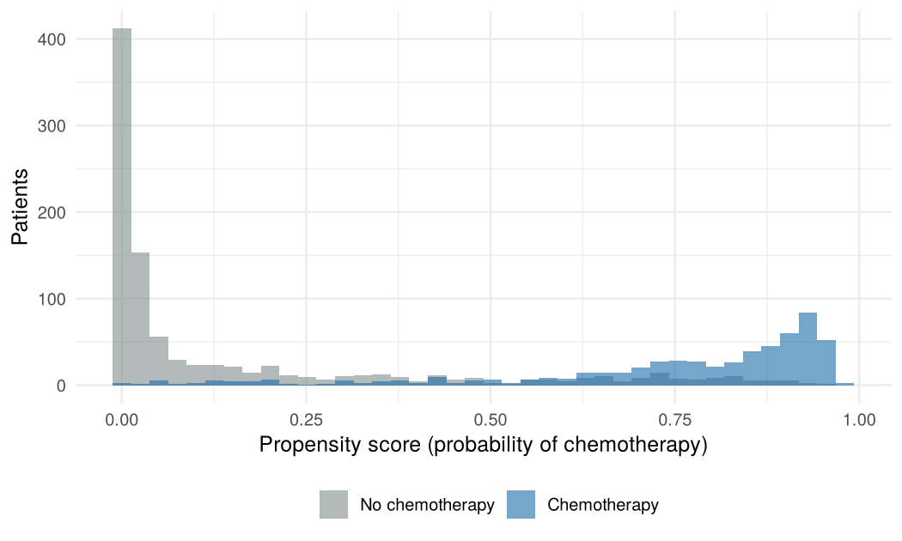
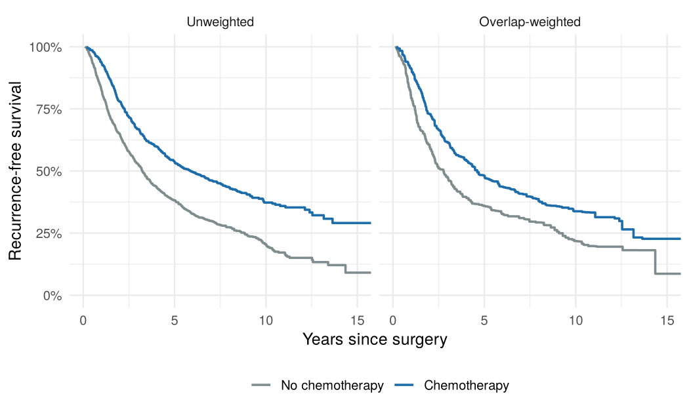
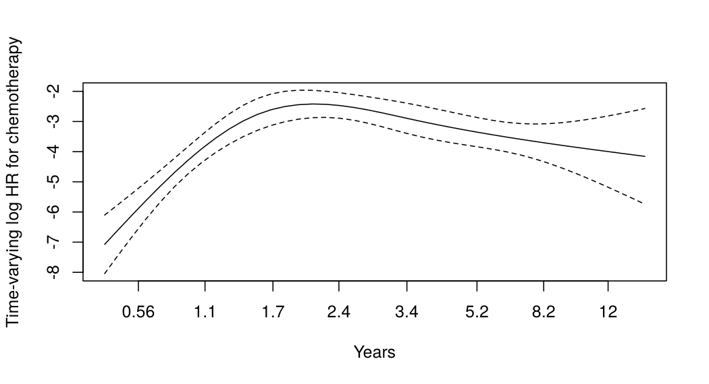

Case 2: Propensity-score weighting for a survival outcome
================

- [Question](#question)
- [Data](#data)
- [Analysis plan](#analysis-plan)
- [1. Propensity-score model and
  overlap](#1-propensity-score-model-and-overlap)
- [2. Weights and their diagnostics](#2-weights-and-their-diagnostics)
  - [Covariate balance](#covariate-balance)
- [3. Weighted hazard ratio](#3-weighted-hazard-ratio)
- [4. Weighted survival curves](#4-weighted-survival-curves)
- [5. Proportional hazards and an AFT sensitivity
  analysis](#5-proportional-hazards-and-an-aft-sensitivity-analysis)
- [Conclusions](#conclusions)
- [Limitations](#limitations)
- [References](#references)

## Question

Among women with node-positive breast cancer, **is adjuvant chemotherapy
associated with longer recurrence-free survival** once differences in
who received it are accounted for?

Chemotherapy was not randomized. Doctors gave it mainly to younger,
premenopausal women, who also differ in prognosis. This case walks
through a propensity-score analysis and, importantly, shows how to tell
when a standard inverse-probability weighting (IPTW) analysis is not
trustworthy and what to do instead.

## Data

`survival::rotterdam`: 2,982 primary breast cancer patients from the
Rotterdam tumour bank (1978–1993).

- **Outcome:** recurrence-free survival (RFS), the time to recurrence or
  death, whichever comes first, in years. Defined as in the `survival`
  package documentation.
- **Exposure:** adjuvant chemotherapy (`chemo`).
- **Confounders:** age, menopausal status, tumour size, grade, number of
  positive nodes, progesterone and estrogen receptor levels, hormonal
  therapy and year of surgery.

``` r
with(rotterdam, table(chemo = chemo, node_positive = nodes > 0))
```

    ##      node_positive
    ## chemo FALSE TRUE
    ##     0  1436  966
    ##     1     0  580

No node-negative patient received chemotherapy, so their probability of
treatment is zero and no method can estimate a treatment effect for them
(a *positivity* violation). The analysis is therefore restricted to
node-positive patients.

``` r
r <- rotterdam |>
  filter(nodes > 0) |>
  mutate(
    rfs     = pmax(recur, death),
    rfstime = ifelse(recur == 1, rtime, dtime) / 365.25,
    lnodes  = log(nodes),
    lpgr    = log1p(pgr),
    ler     = log1p(er),
    grade3  = as.integer(grade == 3),
    group   = factor(chemo, 0:1, c("No chemotherapy", "Chemotherapy"))
  )

r |>
  group_by(group) |>
  summarise(n = n(), events = sum(rfs), `median age` = median(age),
            `% premenopausal` = round(100 * mean(meno == 0)),
            `median nodes` = median(nodes), `% hormonal therapy` = round(100 * mean(hormon))) |>
  knitr::kable()
```

| group           |   n | events | median age | % premenopausal | median nodes | % hormonal therapy |
|:----------------|----:|-------:|-----------:|----------------:|-------------:|-------------------:|
| No chemotherapy | 966 |    736 |         63 |              14 |            4 |                 32 |
| Chemotherapy    | 580 |    344 |         45 |              85 |            2 |                  5 |

The groups are very different: treated women are 18 years younger at the
median and mostly premenopausal, and they less often received hormonal
therapy.

## Analysis plan

1.  Fit a propensity-score (PS) model for chemotherapy with flexible
    (spline) terms for continuous confounders.
2.  Check overlap of the PS distributions and the effective sample size
    (ESS) of the weights.
3.  Estimate the average treatment effect (ATE) with stabilized IPTW;
    check covariate balance with standardized mean differences (SMD;
    target \|SMD\| \< 0.1).
4.  If ATE weights fail the checks, switch to **overlap weights**, which
    target the patients for whom treatment decisions were genuinely
    uncertain.
5.  Estimate the weighted hazard ratio with a bootstrap CI that re-fits
    the PS model in each resample; show weighted survival curves.
6.  Check proportional hazards and fit a weighted Weibull accelerated
    failure time (AFT) model as a sensitivity analysis.

## 1. Propensity-score model and overlap

``` r
ps_formula <- chemo ~ ns(age, 4) + meno + size + grade3 + ns(lnodes, 3) +
  ns(lpgr, 3) + ns(ler, 3) + hormon + year

fit_ps <- function(data) fitted(glm(ps_formula, data = data, family = binomial))

r$ps <- fit_ps(r)
```

``` r
ggplot(r, aes(ps, fill = group)) +
  geom_histogram(bins = 40, alpha = 0.6, position = "identity") +
  scale_fill_manual(values = c("#7f8c8d", "#1b6ca8")) +
  labs(x = "Propensity score (probability of chemotherapy)", y = "Patients", fill = NULL) +
  theme(legend.position = "bottom")
```

<!-- -->

Many untreated patients have propensity scores near 0 (mostly older,
postmenopausal women) and many treated patients have scores near 1.
Overlap is poor at both ends.

## 2. Weights and their diagnostics

``` r
make_weights <- function(z, e) {
  p1 <- mean(z)
  list(
    iptw    = ifelse(z == 1, p1 / e, (1 - p1) / (1 - e)),   # stabilized ATE weights
    overlap = ifelse(z == 1, 1 - e, e)                       # overlap (ATO) weights
  )
}
w <- make_weights(r$chemo, r$ps)

ess <- function(w, z) tapply(w, z, function(v) sum(v)^2 / sum(v^2))

tibble(
  Weights = c("Stabilized IPTW (ATE)", "Overlap (ATO)"),
  `Max weight` = sapply(w, max),
  `ESS untreated` = sapply(w, function(v) ess(v, r$chemo)[["0"]]),
  `ESS treated`   = sapply(w, function(v) ess(v, r$chemo)[["1"]])
) |>
  mutate(across(where(is.numeric), \(x) round(x, 1))) |>
  knitr::kable()
```

| Weights               | Max weight | ESS untreated | ESS treated |
|:----------------------|-----------:|--------------:|------------:|
| Stabilized IPTW (ATE) |      196.3 |         447.2 |        11.0 |
| Overlap (ATO)         |        1.0 |         263.7 |       317.2 |

The ATE weights are dominated by a handful of patients: the largest
weight is 196, and the 580 treated patients carry the information of
only about 11. The extreme weights belong to the few older,
postmenopausal women who received chemotherapy even though almost nobody
like them did. To estimate what would happen if *every* node-positive
patient were treated, IPTW has to let these few women stand in for
hundreds of similar untreated patients, so the ATE estimate hinges on
them.

### Covariate balance

``` r
X <- model.matrix(~ age + meno + size + grade3 + nodes + lpgr + ler + hormon + year, r)[, -1]

smd <- function(wt) {
  apply(X, 2, function(x) {
    m1 <- weighted.mean(x[r$chemo == 1], wt[r$chemo == 1])
    m0 <- weighted.mean(x[r$chemo == 0], wt[r$chemo == 0])
    (m1 - m0) / sqrt((var(x[r$chemo == 1]) + var(x[r$chemo == 0])) / 2)
  })
}

bal <- tibble(
  covariate = colnames(X),
  Unweighted = smd(rep(1, nrow(r))),
  `Stabilized IPTW` = smd(w$iptw),
  Overlap = smd(w$overlap)
) |>
  pivot_longer(-covariate, names_to = "weights", values_to = "smd") |>
  mutate(weights = factor(weights, c("Unweighted", "Stabilized IPTW", "Overlap")),
         covariate = recode(covariate, age = "Age", meno = "Postmenopausal",
                            `size20-50` = "Size 20-50 mm", `size>50` = "Size >50 mm",
                            grade3 = "Grade 3", nodes = "Positive nodes", lpgr = "log(PgR + 1)",
                            ler = "log(ER + 1)", hormon = "Hormonal therapy", year = "Year of surgery"))

ggplot(bal, aes(abs(smd), reorder(covariate, abs(smd)), colour = weights, shape = weights)) +
  geom_vline(xintercept = 0.1, linetype = "dashed") +
  geom_point(size = 2.5) +
  scale_colour_manual(values = c("#7f8c8d", "#c0392b", "#1b6ca8")) +
  labs(x = "|Standardized mean difference|", y = NULL, colour = NULL, shape = NULL) +
  theme(legend.position = "bottom")
```

<!-- -->

IPTW leaves several covariates badly imbalanced (number of nodes, age,
PgR), so its ATE estimate is not credible. Overlap weights balance every
covariate in the PS model exactly (SMD ≈ 0), a known property of overlap
weighting with a logistic PS model.

The price is a different target population. Overlap weights estimate the
effect among patients with intermediate propensity scores, those who
plausibly could have received either treatment. That is a clinically
meaningful population, but it is not “all node-positive patients”, and
the result should be described that way.

## 3. Weighted hazard ratio

The bootstrap re-fits the PS model and the weights in each resample, so
the confidence interval reflects uncertainty in the PS as well as in the
outcome model.

``` r
hr_fit <- function(data, wt) {
  exp(coef(coxph(Surv(rfstime, rfs) ~ chemo, data = data, weights = wt)))
}

boot_hr <- function(B = 500) {
  replicate(B, {
    b  <- r[sample(nrow(r), replace = TRUE), ]
    wb <- make_weights(b$chemo, fit_ps(b))
    c(iptw = hr_fit(b, wb$iptw), overlap = hr_fit(b, wb$overlap))
  })
}
boot <- boot_hr(500)

adj_cox <- coxph(Surv(rfstime, rfs) ~ chemo + ns(age, 4) + meno + size + grade3 +
                   ns(lnodes, 3) + ns(lpgr, 3) + ns(ler, 3) + hormon + year, data = r)
unadj   <- coxph(Surv(rfstime, rfs) ~ chemo, data = r)

ci_model <- function(fit) exp(c(coef(fit)[["chemo"]], confint(fit)["chemo", ]))
ci_boot  <- function(est, draws) c(est, quantile(draws, c(0.025, 0.975)))

results <- rbind(
  "Unadjusted Cox"                 = ci_model(unadj),
  "Covariate-adjusted Cox"         = ci_model(adj_cox),
  "Stabilized IPTW (ATE)"          = ci_boot(hr_fit(r, w$iptw),    boot["iptw.chemo", ]),
  "Overlap weights (ATO)"          = ci_boot(hr_fit(r, w$overlap), boot["overlap.chemo", ])
)
colnames(results) <- c("HR", "Lower 95%", "Upper 95%")
knitr::kable(round(results, 2), caption = "Hazard ratio for recurrence or death, chemotherapy vs. none")
```

|                        |   HR | Lower 95% | Upper 95% |
|:-----------------------|-----:|----------:|----------:|
| Unadjusted Cox         | 0.60 |      0.53 |      0.68 |
| Covariate-adjusted Cox | 0.62 |      0.51 |      0.75 |
| Stabilized IPTW (ATE)  | 0.78 |      0.35 |      1.64 |
| Overlap weights (ATO)  | 0.70 |      0.58 |      0.82 |

Hazard ratio for recurrence or death, chemotherapy vs. none

- The **overlap-weighted** HR is 0.70 (95% CI 0.58–0.82): in patients
  for whom chemotherapy was a genuine choice, it was associated with a
  roughly 30% lower hazard of recurrence or death.
- The **IPTW** interval (0.35–1.64) is far wider, reflecting the extreme
  weights rather than real information about the ATE.
- The unadjusted and covariate-adjusted Cox estimates are similar to the
  overlap estimate here, but the regression-adjusted model extrapolates
  across regions with little overlap, which the weighting diagnostics
  make visible and the regression output does not.

## 4. Weighted survival curves

``` r
km_w <- survfit(Surv(rfstime, rfs) ~ group, data = r, weights = w$overlap)
km_u <- survfit(Surv(rfstime, rfs) ~ group, data = r)

tidy_km <- function(fit, label) {
  tibble(time = fit$time, surv = fit$surv,
         group = rep(sub("group=", "", names(fit$strata)), fit$strata), type = label)
}

bind_rows(tidy_km(km_u, "Unweighted"), tidy_km(km_w, "Overlap-weighted")) |>
  mutate(type = factor(type, c("Unweighted", "Overlap-weighted")),
         group = factor(group, levels(r$group))) |>
  ggplot(aes(time, surv, colour = group)) +
  geom_step(linewidth = 0.8) +
  facet_wrap(~ type) +
  coord_cartesian(xlim = c(0, 15)) +
  scale_colour_manual(values = c("#7f8c8d", "#1b6ca8")) +
  scale_y_continuous(labels = scales::percent, limits = c(0, 1)) +
  labs(x = "Years since surgery", y = "Recurrence-free survival", colour = NULL) +
  theme(legend.position = "bottom")
```

<!-- -->

In the overlap-weighted population, 5-year recurrence-free survival was
48% with chemotherapy and 36% without.

## 5. Proportional hazards and an AFT sensitivity analysis

``` r
cox_ow <- coxph(Surv(rfstime, rfs) ~ chemo, data = r, weights = w$overlap)
zph <- cox.zph(cox_ow)
zph
```

    ##        chisq df    p
    ## chemo   1.99  1 0.16
    ## GLOBAL  1.99  1 0.16

``` r
plot(zph, resid = FALSE, xlab = "Years", ylab = "Time-varying log HR for chemotherapy")
abline(h = coef(cox_ow), lty = 2, col = "grey40")
```

<!-- -->

The Schoenfeld test gives p = 0.16. There is no strong evidence against
proportional hazards.

A Weibull AFT model describes the effect as a ratio of survival times
instead of hazards:

``` r
aft <- survreg(Surv(rfstime, rfs) ~ chemo, data = r, weights = w$overlap, dist = "weibull")
tr  <- exp(coef(aft)[["chemo"]])

tr_boot <- replicate(300, {
  b  <- r[sample(nrow(r), replace = TRUE), ]
  wb <- make_weights(b$chemo, fit_ps(b))$overlap
  exp(coef(survreg(Surv(rfstime, rfs) ~ chemo, data = b, weights = wb, dist = "weibull"))[["chemo"]])
})
tr_ci <- quantile(tr_boot, c(0.025, 0.975))
```

The overlap-weighted time ratio is 1.52 (95% CI 1.23–1.91): chemotherapy
was associated with recurrence-free time about 52% longer, consistent
with the Cox result.

## Conclusions

- Chemotherapy was associated with better recurrence-free survival among
  node-positive patients whose treatment was clinically uncertain
  (overlap-weighted HR 0.70).
- A naive IPTW analysis for the whole node-positive population would
  have been driven by a few extreme weights and left major confounders
  imbalanced. Checking overlap, ESS and SMDs before reading the effect
  estimate is what revealed this.

## Limitations

- **Unmeasured confounding:** performance status, comorbidity and
  patient preference are not recorded and plausibly influenced both
  treatment and outcome.
- **Target population:** the overlap-weighted estimate applies to
  patients near clinical equipoise, not to all node-positive patients.
- **Treatment definition:** chemotherapy regimens and timing are not
  recorded, and hormonal therapy is treated as a baseline covariate.
- **Historical cohort:** treatment practice has changed substantially
  since 1978–1993.

## References

- Royston P, Altman DG. External validation of a Cox prognostic model:
  principles and methods. *BMC Med Res Methodol* 2013;13:33. (Source of
  the Rotterdam data.)
- Austin PC, Stuart EA. Moving towards best practice when using inverse
  probability of treatment weighting (IPTW) using the propensity score
  to estimate causal treatment effects in observational studies. *Stat
  Med* 2015;34:3661–79.
- Li F, Morgan KL, Zaslavsky AM. Balancing covariates via propensity
  score weighting. *JASA* 2018;113:390–400.

<!-- -->

    ## [1] "R version 4.3.3 (2024-02-29)"
