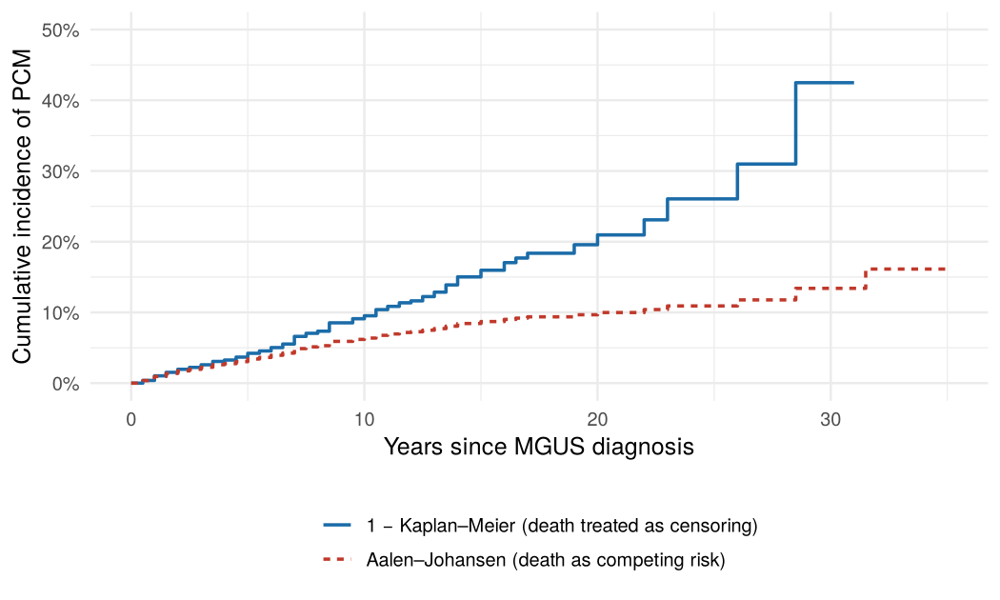
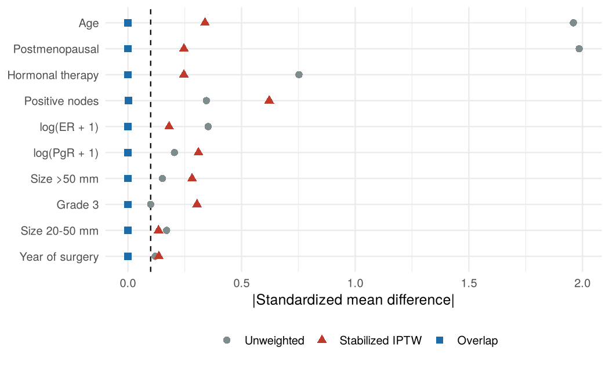
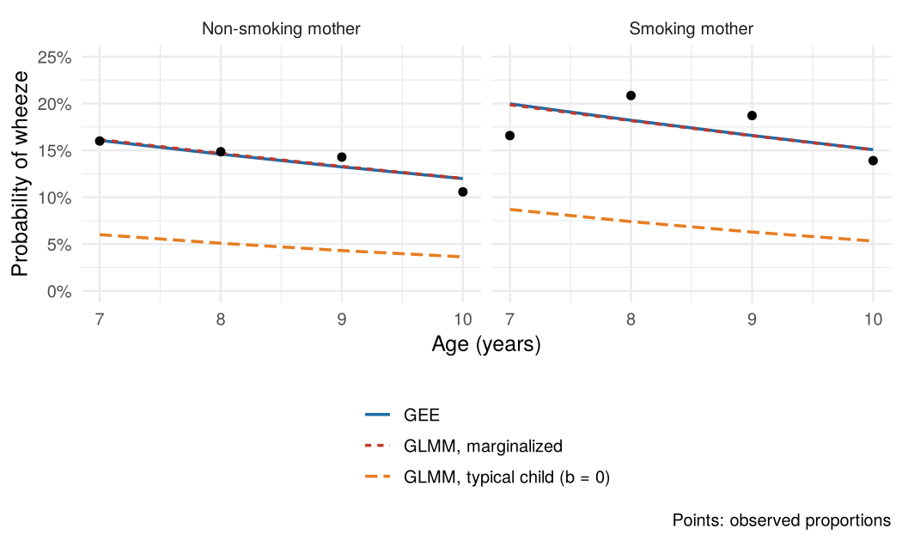

# Survival and Longitudinal Analysis Casebook

Three short, fully reproducible statistical analyses in R. Each is written like a brief analysis report (question, data, analysis plan, results, interpretation and limitations) and uses public data that ship with R packages, so every result can be re-run in a few minutes.

| Case | Question | Methods |
|---|---|---|
| [1. Competing risks](01-competing-risks/competing-risks.md) | What is the long-term risk of MGUS progressing to myeloma when most patients die of other causes first? | Aalen–Johansen cumulative incidence, cause-specific Cox, Fine–Gray, PH diagnostics |
| [2. Propensity-score weighting](02-iptw-survival/iptw-survival.md) | Is adjuvant chemotherapy associated with longer recurrence-free survival in node-positive breast cancer? | Propensity scores, stabilized IPTW, overlap weights, SMD balance, effective sample size, bootstrap CIs, weighted KM, Cox and Weibull AFT |
| [3. GEE vs. GLMM](03-gee-vs-glmm/gee-vs-glmm.md) | Is maternal smoking associated with childhood wheeze across repeated annual visits? | GEE with four working correlations, random-intercept GLMM, robust vs. model-based SEs, marginalizing a GLMM |

## Key findings

### 1. Ignoring competing risks triples the estimated risk of progression



Treating death as censoring (1 − Kaplan–Meier) put the 30-year risk of progressing to a plasma-cell malignancy at 42.5%; the Aalen–Johansen estimate, which accounts for death as a competing event, was 13.4%. Age illustrates why cause-specific and subdistribution hazards must be read differently: it barely changes the rate of progression (cause-specific HR 1.01 per year) but lowers the chance of ever progressing (Fine–Gray HR 0.98), because older patients more often die first.

### 2. Checking overlap before trusting an IPTW estimate



Chemotherapy was given almost only to younger, premenopausal women. Stabilized IPTW weights reached 196, left the 580 treated patients with an effective sample size of about 11, and failed to balance several confounders. Overlap weights balanced every covariate exactly and gave an HR for recurrence or death of 0.70 (95% bootstrap CI 0.58–0.82) among patients for whom chemotherapy was a genuine choice. A weighted Weibull model gave a consistent time ratio of 1.52.

### 3. Marginal and conditional odds ratios answer different questions



The GLMM's child-specific coefficients were about 1.5 times the GEE's population-averaged ones (smoking OR 1.49 vs. 1.30), close to the 1.62 ratio predicted from the random-effect SD of 2.16. Integrating the GLMM over the random-effect distribution reproduces the GEE fit and the observed proportions, while the "typical child" curve does not.

## Reproducing the analyses

Requires R (≥ 4.3) and pandoc (bundled with RStudio).

```r
install.packages(c("survival", "geepack", "lme4", "ggplot2", "dplyr", "tidyr",
                   "broom", "scales", "rmarkdown", "knitr"))
source("render_all.R")
```

Each `.Rmd` renders to a GitHub-flavoured `.md` report with its figures. Bootstrap steps use a fixed seed. The reports were rendered with R 4.3.3, survival 3.5.8, geepack 1.3.10 and lme4 1.1.35.1.

## Data sources

| Dataset | Package | Original study |
|---|---|---|
| `mgus2` | survival | Kyle et al., *NEJM* 2002 (Mayo Clinic MGUS cohort) |
| `rotterdam` | survival | Rotterdam tumour bank, 1978–1993 (Royston & Altman, 2013) |
| `ohio` | geepack | Harvard Six Cities Study (Ware et al., 1984) |

## Author

Caroline Song · MS Biostatistics, Harvard T.H. Chan School of Public Health
